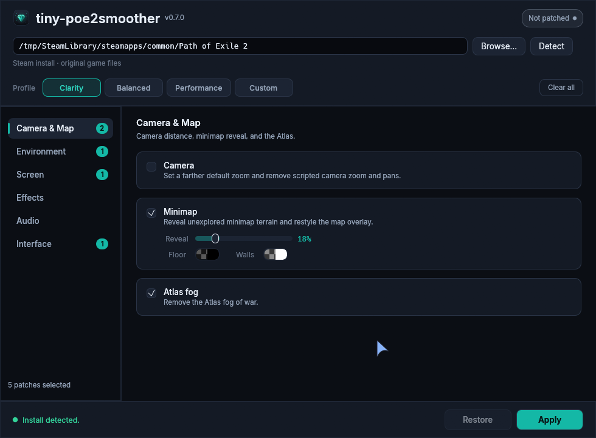

# tiny-poe2smoother

tiny-poe2smoother is a desktop app that turns down visual and sound effects in Path of Exile 2. It cuts visual clutter and may improve performance. It only changes local game bundle files, and it makes a backup before applying changes.



## Features

Pick a profile or choose patches yourself. Patches with sub-options expand when checked, so you can keep the parts you like.

| Area | Patches |
| --- | --- |
| Camera & Map | Camera zoom (1.2× to 2.4×), minimap reveal with custom colors, no Atlas fog of war |
| Environment | Fog, rain, clouds, weather particles, bloom, shadows, lighting |
| Screen | No vignette, depth of field, or chill and low life filters. Black screen mode that keeps the UI |
| Effects | Fewer skill and monster effects, particles, and Delirium. No MTX effects |
| Audio | Mute effect sounds, or only skill or monster sounds |
| Interface | Colored mod text, compact Alt tooltips (English client), always visible health bars |

Also:

- Clarity, Balanced, and Performance profiles.
- An effects editor to keep chosen skills and monsters looking original.
- A color editor for mod text on waystones, items, and tablets. Search supports `fire|cold`, `"quoted phrases"`, and `!monster`.
- Finds Steam and standalone installs, and remembers your settings.
- Makes a backup before patching.

## Trust and privacy

- No telemetry, no analytics, and no auto-updater. The app makes no network calls and sends no data anywhere.
- [GitHub Actions](.github/workflows/release.yml) builds every release from tagged source, and published releases are [immutable on GitHub](https://github.com/kengzzzz/tiny-poe2smoother/releases).

## Download

Get the latest Windows executable or Linux archive from the [releases page](https://github.com/kengzzzz/tiny-poe2smoother/releases).

### Windows

1. Run `poe2smoother-windows-x86_64.exe`.
2. If Windows SmartScreen warns about an unknown app, choose **More info**, then **Run anyway**.

### Linux

1. Extract `poe2smoother-linux-x86_64.tar.gz`.
2. Run `./poe2smoother`.

If the file lost its executable permission, run `chmod +x poe2smoother` first.

### Arch Linux

Install the prebuilt [`tiny-poe2smoother-bin`](https://aur.archlinux.org/packages/tiny-poe2smoother-bin) package from the AUR:

```sh
paru -S tiny-poe2smoother-bin
```

Then run `poe2smoother`.

## Usage

1. Close Path of Exile 2.
2. Let the app find the game folder, or pick it with **Browse**.
3. Pick a profile, or check patches in the categories on the left. Use **Edit colors…** or **Edit effects…** for finer control.
4. Click **Apply** and confirm.
5. Click **Restore** before you apply a different selection, and before you update or verify the game.

## Safety notes

- Apply and Restore are blocked while Path of Exile 2 is running.
- The backup lives in `tiny-poe2smoother/poe2.bak` under your local app data folder.
- If the game crashes or won't start, click **Restore**, then verify the game files in Steam or the standalone launcher.
- If a game update changes the bundle layout, the app may refuse to patch until tiny-poe2smoother is updated.

## How it works

The app edits the game's bundle files in place and saves the original data to a backup. **Restore** puts it back.

## Build from source

```sh
cargo build --release
```

Run `cargo run --release` to start the GUI from source. The Rust version is pinned in [rust-toolchain.toml](rust-toolchain.toml), and rustup installs it for you.

Linux builds need the GTK3, XCB, and Wayland development libraries. The [Dockerfile](Dockerfile) can also cross-compile for Windows and Linux.

## Credits

The GUI embeds the [Inter](https://github.com/rsms/inter) typeface, licensed under the [SIL Open Font License 1.1](assets/fonts/OFL.txt).

Oodle-compatible compression and decompression comes from [Powzix's ooz](https://github.com/powzix/ooz) (GPL-3). See [vendor/ooz/ATTRIBUTION](vendor/ooz/ATTRIBUTION).
